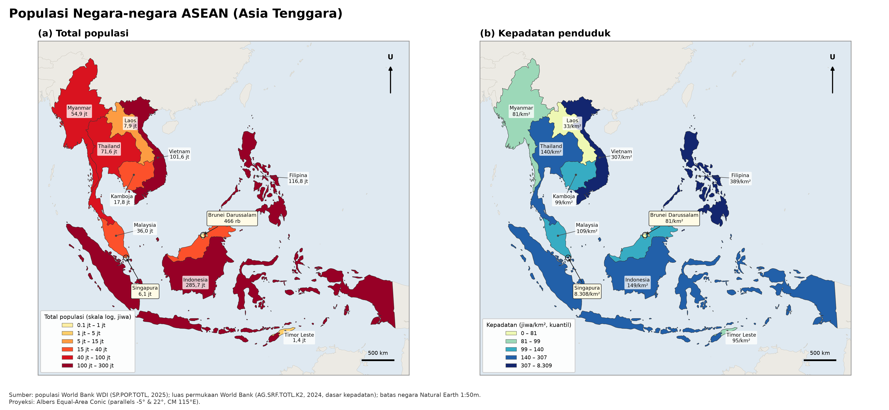

# 🗺️ Choropleth Populasi ASEAN


Peta choropleth populasi 11 negara Asia Tenggara (ASEAN) dengan proyeksi *equal-area*, notebook Jupyter yang dapat dijalankan ulang, dan dashboard HTML interaktif yang bisa dibuka langsung di browser tanpa server.



## Daftar Isi
- [Tujuan](#tujuan)
- [Struktur proyek](#struktur-proyek)
- [Instalasi](#instalasi)
- [Cara menjalankan](#cara-menjalankan)
- [Sumber data](#sumber-data)
- [Keputusan desain](#keputusan-desain)
- [Hasil](#hasil)
- [Pengecekan](#pengecekan)

## Tujuan
- [x] Menampilkan total populasi dan kepadatan 11 negara ASEAN dalam dua panel.
- [x] Memakai proyeksi equal-area yang sesuai untuk wilayah ini.
- [x] Memakai populasi terbaru dari sumber resmi (bukan `POP_EST` Natural Earth).
- [x] Menyediakan alur yang dapat diulang (notebook + modul `src/`).
- [x] Menyediakan dashboard interaktif dengan panel pengecekan.

## Struktur proyek
```text
.
├── data/
│   ├── raw/                  # (di-.gitignore) zip Natural Earth, JSON World Bank (populasi & luas), SOURCE.json
│   └── processed/            # GeoJSON gabungan, CSV metrik
├── notebooks/
│   └── asean_population_choropleth.ipynb
├── src/
│   ├── load_data.py          # unduh, ekstrak aman, filter, join populasi + luas resmi
│   ├── project.py            # Albers/LAEA, luas geometri, kepadatan
│   ├── plot.py               # peta dua panel
│   ├── validate.py           # pengecekan otomatis (python -I src/validate.py)
│   ├── build_static.py       # data olahan + PNG/SVG
│   ├── build_dashboard.py    # membangun outputs/dashboard.html
│   └── dashboard_template.html
├── outputs/                  # PNG (300 dpi), SVG, dashboard.html
├── requirements.txt
├── environment.yml
├── pyproject.toml / uv.lock  # konfigurasi uv (opsional)
└── .gitignore
```

## Instalasi
**pip**
```bash
python -m venv .venv
source .venv/bin/activate        # Windows: .venv\Scripts\activate
pip install -r requirements.txt
```
**conda**
```bash
conda env create -f environment.yml
conda activate asean-population-map
```

## Cara menjalankan
```bash
# Notebook (jalankan dari akar proyek)
jupyter lab notebooks/asean_population_choropleth.ipynb

# Atau lewat skrip
python -I src/build_static.py       # PNG + SVG + data olahan
python -I src/build_dashboard.py    # outputs/dashboard.html
```
**Kernel Jupyter** (notebook memakai kernel `asean-pop`):
```bash
# daftarkan (dari lingkungan yang sudah berisi dependensi)
python -m ipykernel install --user --name asean-pop --display-name "ASEAN Population (.venv)"
# hapus bila tidak lagi dibutuhkan
jupyter kernelspec uninstall asean-pop
```
Perintah ini hanya menyentuh kernel `asean-pop`, tidak mengubah konfigurasi Jupyter lain.

**Dashboard:** buka `outputs/dashboard.html` langsung dengan klik ganda (tidak perlu server atau internet; plotly.js ditanam di dalam file).

## Sumber data
| Data | Sumber | Catatan |
|---|---|---|
| Batas negara | [Natural Earth 1:50m admin-0](https://www.naturalearthdata.com/downloads/50m-cultural-vectors/50m-admin-0-countries-2/) | Domain publik; 110m tidak dipakai karena Singapura dan Brunei tidak terbaca |
| Populasi | [World Bank WDI, SP.POP.TOTL](https://data.worldbank.org/indicator/SP.POP.TOTL) | CC BY 4.0; tahun **2025**; JSON mentah + metadata di `data/raw/worldbank/` |
| Luas permukaan | [World Bank WDI, AG.SRF.TOTL.K2](https://data.worldbank.org/indicator/AG.SRF.TOTL.K2) | CC BY 4.0; dasar perhitungan kepadatan. Tahun 2025 **belum tersedia**; dipakai tahun terbaru yang ada untuk semua negara, yaitu **2024** (dicatat di kolom `area_year`) |

> `data/raw/` masuk `.gitignore`; jalankan pipeline untuk mengunduhnya kembali (sumber dan tanggal unduh tercatat di `data/raw/worldbank/SOURCE.json`).

Negara difilter dengan `ADM0_A3` (bukan `ISO_A3`, yang bisa berisi `-99`) dan digabung dengan populasi lewat ISO3.

## Keputusan desain
**Proyeksi: Albers Equal-Area Conic** (parallels −5° & 22°, meridian pusat 115°E, lintang asal 5°).
- *Equal-area* wajib karena ada peta kepadatan dan perbandingan area.
- Dibandingkan dengan Lambert Azimuthal Equal-Area (pusat 115°E, 5°N): distorsi sudut **maksimum** Albers lebih kecil (±3,7° vs ±5,1°), tetapi **rata-ratanya** lebih tinggi (±2,7° vs ±1,7°). Dipilih Albers agar tepi wilayah (Myanmar utara, Filipina utara, Papua) tidak terdistorsi kuat; perbedaan visualnya kecil. Perbandingan lengkap ada di notebook.
- Karena meridian miring di luar 115°E, panah utara adalah "utara grid".

**Skala warna**
- Total populasi: kelas **skala log** (0,1–1; 1–5; 5–15; 15–40; 40–100; 100–300 juta), karena rentangnya 0,47 juta hingga 286 juta.
- Kepadatan: **kuantil** (k=5), karena Singapura (≈8.308/km²) jauh melampaui yang lain dan akan meratakan skala linear.
- Palet ColorBrewer sekuensial YlOrRd dan YlGnBu (ramah buta warna).

> ⚠️ **Bias luas pada total populasi.** Choropleth total populasi membuat negara luas (Indonesia, Myanmar) tampak "lebih penting" secara visual, sementara Singapura dan Brunei nyaris tak terlihat. Karena itu ada callout untuk keduanya dan panel kepadatan sebagai pendamping. Baca kedua panel bersama-sama.

> ℹ️ **Kepadatan memakai luas resmi World Bank**, bukan luas dari geometri. Luas geometri Natural Earth 1:50m (dihitung di CRS equal-area) hanya perkiraan karena garis pantai digeneralisasi dan dipakai sebagai pembanding (kolom `area_geom_km2` dan `area_diff_pct`). Selisih terbesar ada di **Singapura (−34,4%)**: geometri 483 km² vs resmi 736 km². Selisih ini ditandai (>10%) di validasi dan dashboard; negara lain berselisih ≤ 3,6%. Luas resmi bertahun 2024 sedangkan populasi 2025.

## Hasil
| Negara | ISO3 | Populasi (2025) | Luas resmi (km²) | Luas geometri (km²) | Selisih | Kepadatan (jiwa/km²) |
|---|---|---:|---:|---:|---:|---:|
| Indonesia | IDN | 285.721.236 | 1.916.907 | 1.863.901 | −2,8% | 149,1 |
| Filipina | PHL | 116.786.962 | 300.000 | 289.182 | −3,6% | 389,3 |
| Vietnam | VNM | 101.598.527 | 331.338 | 327.848 | −1,1% | 306,6 |
| Thailand | THA | 71.619.863 | 513.115 | 513.910 | +0,2% | 139,6 |
| Myanmar | MMR | 54.850.648 | 676.578 | 660.975 | −2,3% | 81,1 |
| Malaysia | MYS | 35.977.838 | 330.534 | 326.203 | −1,3% | 108,8 |
| Kamboja | KHM | 17.847.982 | 181.035 | 180.670 | −0,2% | 98,6 |
| Laos | LAO | 7.873.046 | 236.800 | 228.232 | −3,6% | 33,2 |
| Singapura | SGP | 6.111.175 | 736 | 483 | **−34,4% ⚠** | 8.307,7 |
| Timor Leste | TLS | 1.418.517 | 14.870 | 14.959 | +0,6% | 95,4 |
| Brunei Darussalam | BRN | 466.330 | 5.770 | 5.647 | −2,1% | 80,8 |

Total ASEAN: **700.272.124** jiwa. Berkas: [PNG](outputs/asean_population_choropleth.png) · [SVG](outputs/asean_population_choropleth.svg) · [dashboard](outputs/dashboard.html).

## Pengecekan
- [x] 11/11 negara ditemukan dan berwarna di kedua panel
- [x] Join populasi 11/11, tidak ada nilai hilang
- [x] Seluruh geometri valid
- [x] Luas resmi tersedia 11/11
- [x] Kepadatan = populasi / luas resmi
- [x] Luas geometri Albers dan LAEA konsisten (selisih maks 0,001%)
- [ ] ⚠ Selisih luas geometri vs resmi ≤ 10%: **dilaporkan, 1 negara ditandai (Singapura, −34,4%)**
- [x] Tiga negara (IDN, SGP, TLS) dihitung ulang dari JSON mentah dan cocok
- [x] Tidak ada label yang saling tumpang tindih
- [x] Dashboard memuat 11 negara, tabel dapat diurutkan, toggle berfungsi, tanpa error konsol

Status `python -I src/validate.py`: semua pengecekan LOLOS, dengan 1 PERINGATAN (selisih luas Singapura di atas). Rincian ada di bagian **Validasi** pada notebook dan panel pengecekan di dashboard.
